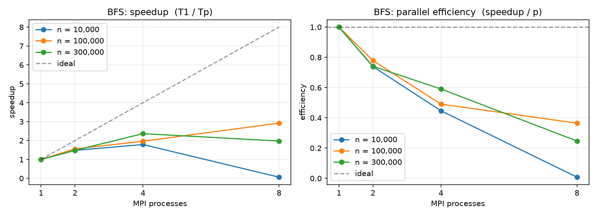
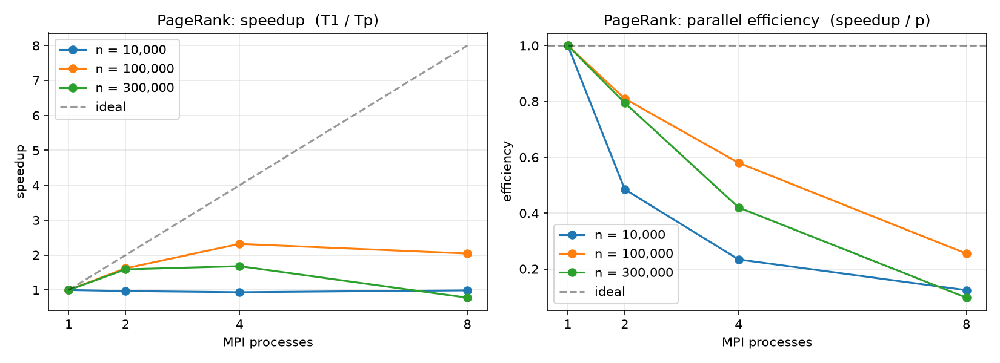

# Distributed Graph Processing Engine (Python + mpi4py)

A small distributed graph processing engine: **BFS** (shortest hop distances) and
**PageRank** on a graph whose vertices are partitioned across MPI processes.
Everything runs on one Windows laptop using several MPI processes. It is a learning
and portfolio project, with a sequential baseline, correctness tests against that
baseline, and a benchmark harness.

## What is implemented

- Edge-list reader (`u v` per line) into a SciPy CSR matrix, plus a random graph generator
- Sequential BFS and PageRank (the correctness reference)
- 1D block vertex partition across MPI ranks
- Parallel BFS: level-synchronous, frontier exchange with `alltoall`
- Parallel PageRank: `Allgatherv` of rank contributions plus two scalar `allreduce`
- 42 tests: parallel results are compared with the sequential ones under real `mpiexec`
- Benchmark script (median of repeated runs, CSV output) and a plotting script

## Project layout

```
gpe/                      the engine
  graph_io.py             edge list -> CSR adjacency matrix
  generate.py             random graph generator
  sequential.py           bfs_seq, pagerank_seq (reference)
  partition.py            1D block partition
  parallel_bfs.py         bfs_mpi
  parallel_pagerank.py    pagerank_mpi
run_parallel.py           runs one algorithm under mpiexec, times it
tests/                    pytest suite
benchmarks/               run_benchmarks.py, plot_results.py
data/                     small.txt, two_node.txt (hand-checkable), generated graphs
results/                  results.csv, plots, results_table.md
hello_mpi.py              setup check
```

## Install (Windows)

1. Install **Python 3.10+** (tested with 3.12.2) and tick "Add python.exe to PATH".
2. Install **Microsoft MPI**: first `msmpisetup.exe` (runtime), then `msmpisdk.msi` (SDK),
   from Microsoft's download page or the `microsoft/Microsoft-MPI` GitHub releases.
   Make sure `C:\Program Files\Microsoft MPI\Bin` is on your PATH, then check that
   `mpiexec -help` prints usage text.
3. Create a virtual environment and install the packages:
   ```
   python -m venv .venv
   .venv\Scripts\activate
   python -m pip install --upgrade pip
   pip install -r requirements.txt
   ```
   If `pip install mpi4py` fails, try `pip install mpi4py impi-rt` (bundles an Intel MPI runtime).
4. Check MPI works:
   ```
   mpiexec -n 4 python hello_mpi.py
   ```
   You should see four "Hello from rank X of 4" lines and `allreduce check: sum of ranks = 6 (expected 6)`.

## Run

```
:: sequential reference
python -c "from gpe.graph_io import read_edge_list as r; from gpe.sequential import *; print(bfs_seq(r('data/small.txt'), 0))"

:: parallel BFS and PageRank
mpiexec -n 4 python run_parallel.py --algo bfs --graph data\small.txt --source 0
mpiexec -n 4 python run_parallel.py --algo pr  --graph data\random_10k.txt --repeats 5

:: generate a random graph (n vertices, ~avg-degree edges per vertex)
python -m gpe.generate --n 10000 --avg-degree 10 --seed 1 --out data\random_10k.txt
```

`run_parallel.py` prints one `RESULT` line (processes, graph size, median time) and can save
the full result with `--out file.npy`.

## Tests

```
python -m pytest -v
```

- BFS: distances must match the sequential result **exactly**, and also a hand-computed
  answer on `data/small.txt`.
- PageRank: damping 0.85, L1 tolerance 1e-10. The parallel ranks must match the sequential
  ones within an L1 distance of 1e-8, and must reproduce a closed-form result on
  `data/two_node.txt` (ranks 1/2.85 and 1.85/2.85).
- Process counts 1, 2, 3, 4 and 8 are used, including more processes than vertices
  (some ranks own nothing) and sources owned by different ranks.
- Sequential code is itself checked against SciPy's shortest paths and a dense linear solve.

## Design

**Partitioning.** Vertices are split into contiguous blocks, one per rank (block sizes
differ by at most 1). Rank `r` owns `[lo, hi)`. Ownership is arithmetic, so no lookup
table is needed. Each rank keeps the graph rows it needs and the values of its own vertices.

**BFS (level-synchronous).** Per level: each rank expands its local frontier into
candidate neighbours, groups them by owner (cheap, because the candidates are sorted and
the blocks are contiguous), and sends them with one `alltoall`. Each owner keeps the
vertices it has not visited yet as its next frontier. An `allreduce` of the frontier sizes
decides when to stop. Distances are integers assigned level by level, so the result does
not depend on message order or process count.

**PageRank.** Pull model: each rank computes the new rank of its own vertices from their
in-edges, so it only writes its own slice. Per iteration: a scalar `allreduce` for the
rank mass on dangling vertices (spread evenly over all vertices), an `Allgatherv` of the
per-vertex contributions `rank/out_degree`, and a scalar `allreduce` of the L1 change so all
ranks stop on the same iteration.

## Benchmark method

```
python benchmarks\run_benchmarks.py --procs 1 2 4 8 --sizes 10000 100000 300000 --repeats 5
python benchmarks\plot_results.py
```

- Graphs: uniform random directed graphs, about 10 edges per vertex, fixed seed.
- Timed: the algorithm call only (graph loading and process start-up are not included). For
  the MPI runs this includes each rank's local setup and the communication. Time is that of
  the slowest rank (a barrier ends each timed run). Each number is the **median of 5 runs**.
- `speedup = T(1 process) / T(p processes)`, using the same MPI code with 1 rank as the
  baseline; `efficiency = speedup / p`. This is **strong scaling** (fixed problem size).
- The "Sequential" column is the plain sequential code on the same graph. The CSV also has
  `speedup_vs_seq`, the stricter comparison against it. The MPI code with 1 rank is not free:
  for BFS it is slower than the sequential code, so speedups vs the 1-process baseline look
  better than speedups vs sequential.

## Results

Machine: Windows 10, Intel Core i7-6700HQ (4 physical cores, 8 logical processors),
16 GB RAM, Python 3.12.2, Microsoft MPI 10.1.12498.52,
mpi4py 4.1.2, NumPy 2.5.5, SciPy 1.18.1.
All processes run on this one laptop, so there is no real network communication.

| Algorithm | Vertices | Edges | Procs | Median time (ms) | Speedup | Efficiency | Sequential (ms) |
|---|---|---|---|---|---|---|---|
| BFS | 10,000 | 99,946 | 1 | 17.9 | 1.000 | 1.000 | 9.6 |
| BFS | 10,000 | 99,946 | 2 | 12.1 | 1.479 | 0.739 | 9.6 |
| BFS | 10,000 | 99,946 | 4 | 10.0 | 1.789 | 0.447 | 9.6 |
| BFS | 10,000 | 99,946 | 8 | 281.5 | 0.064 | 0.008 | 9.6 |
| BFS | 100,000 | 999,946 | 1 | 249.4 | 1.000 | 1.000 | 176.7 |
| BFS | 100,000 | 999,946 | 2 | 160.1 | 1.557 | 0.779 | 176.7 |
| BFS | 100,000 | 999,946 | 4 | 127.0 | 1.963 | 0.491 | 176.7 |
| BFS | 100,000 | 999,946 | 8 | 85.4 | 2.921 | 0.365 | 176.7 |
| BFS | 300,000 | 2,999,941 | 1 | 1025.8 | 1.000 | 1.000 | 633.5 |
| BFS | 300,000 | 2,999,941 | 2 | 692.0 | 1.482 | 0.741 | 633.5 |
| BFS | 300,000 | 2,999,941 | 4 | 433.7 | 2.365 | 0.591 | 633.5 |
| BFS | 300,000 | 2,999,941 | 8 | 519.3 | 1.975 | 0.247 | 633.5 |
| PageRank | 10,000 | 99,946 | 1 | 11.7 | 1.000 | 1.000 | 10.4 |
| PageRank | 10,000 | 99,946 | 2 | 12.0 | 0.970 | 0.485 | 10.4 |
| PageRank | 10,000 | 99,946 | 4 | 12.4 | 0.937 | 0.234 | 10.4 |
| PageRank | 10,000 | 99,946 | 8 | 11.8 | 0.990 | 0.124 | 10.4 |
| PageRank | 100,000 | 999,946 | 1 | 171.6 | 1.000 | 1.000 | 161.7 |
| PageRank | 100,000 | 999,946 | 2 | 105.9 | 1.621 | 0.810 | 161.7 |
| PageRank | 100,000 | 999,946 | 4 | 73.9 | 2.321 | 0.580 | 161.7 |
| PageRank | 100,000 | 999,946 | 8 | 84.0 | 2.043 | 0.255 | 161.7 |
| PageRank | 300,000 | 2,999,941 | 1 | 609.0 | 1.000 | 1.000 | 610.6 |
| PageRank | 300,000 | 2,999,941 | 2 | 382.9 | 1.591 | 0.795 | 610.6 |
| PageRank | 300,000 | 2,999,941 | 4 | 362.2 | 1.682 | 0.420 | 610.6 |
| PageRank | 300,000 | 2,999,941 | 8 | 781.8 | 0.779 | 0.097 | 610.6 |




### What the results show

- **Small graph (10,000 vertices): parallelism does not pay off.** The fastest BFS run
  (4 processes, 10.0 ms) is no faster than the sequential code (9.6 ms), and PageRank is
  about 12 ms at every process count versus 10.4 ms sequential. With so little work per
  process, the cost of synchronising ranks at every BFS level and every PageRank iteration
  is comparable to the computation it splits.
- **Larger graphs speed up, with limits.** On the ~1M-edge graph the best BFS time is 85.4 ms
  at 8 processes (2.9x over 1 process, about 2.1x over sequential) and the best PageRank time
  is 73.9 ms at 4 processes (2.3x over 1 process, about 2.2x over sequential). On the ~3M-edge
  graph the best times are at 4 processes: BFS 2.4x (about 1.5x over sequential) and PageRank
  1.7x (about 1.7x over sequential).
- **Efficiency falls as processes are added** (0.42 to 0.59 at 4 processes on the larger
  graphs), so the speedups are far from ideal.
- **8 processes is not better than 4 in general.** The laptop has 4 physical cores; processes 5
  to 8 share cores through hyper-threading. On the largest graph, 8 processes were slower than 4
  for both algorithms, and PageRank at 8 processes (781.8 ms) was slower than the sequential code.
- **One outlier, not investigated:** BFS with 8 processes on the 10,000-vertex graph took
  281.5 ms versus 10.0 ms with 4. Oversubscription effects (MS-MPI processes spin while
  waiting) are a plausible cause, but I did not confirm it.
- **Why gains are limited (hypotheses, not measured):** each PageRank iteration moves O(n)
  data into every rank (`Allgatherv`), so communication does not shrink as processes are
  added while computation does; sparse matrix-vector products are largely memory-bandwidth
  bound, and all processes share one memory system; every rank holds a copy of the whole
  graph. I did not instrument communication time separately, so this breakdown is
  an explanation consistent with the data and not a measurement.

## Limitations

- **Single machine only.** MPI processes share memory here, so communication is much cheaper
  than on a real cluster. The results say nothing about network scaling.
- **Every rank reads the entire graph file** and builds the full matrix, then uses its slice.
  This limits memory scalability and input time; a real implementation would read in parallel.
- **PageRank uses `Allgatherv`,** sending O(n) data to every rank each iteration. A halo
  exchange (each rank receives only the contributions its in-edges need) would reduce traffic
  for graphs with good locality.
- **Simple 1D block partition with no load balancing.** It is balanced on uniform random
  graphs but would be skewed on real-world graphs with a few very high-degree vertices.
- **BFS exchange uses `alltoall` on pickled arrays** and may send a vertex from several ranks;
  fine at this scale, not optimal.
- **Timing definition.** The timed region includes per-rank setup and communication; loading
  and process start-up are excluded. The 1-process MPI baseline is slower than sequential BFS.
- **Benchmarks use synthetic uniform random graphs only,** one machine, one benchmark session,
  strong scaling only. Timings on a laptop vary with background load and CPU frequency.
- Weak scaling and a measured computation/communication breakdown are not implemented.

## Possible extensions

Halo-exchange PageRank, per-iteration timing of communication vs computation, weak scaling,
degree-aware partitioning, parallel graph reading, and real-world graphs (e.g. SNAP datasets).
